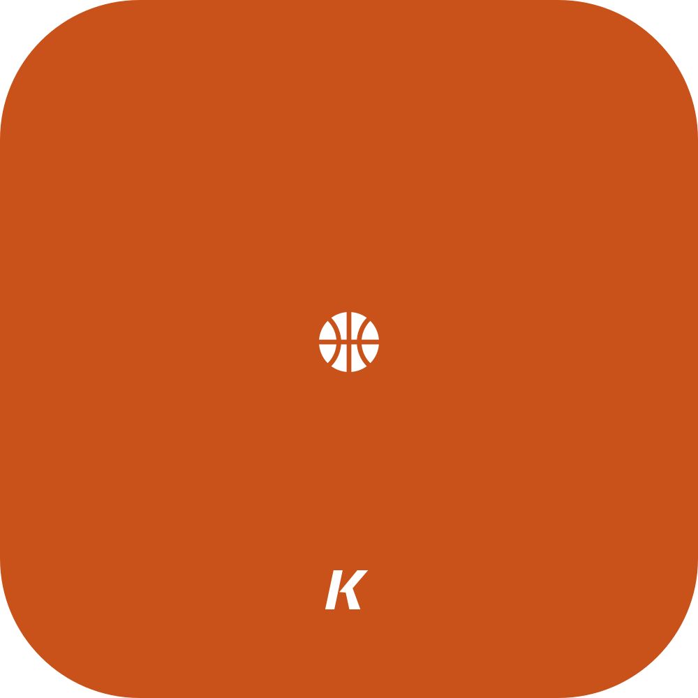

<p align="center"></p>

# Coach OS

Personal high school basketball coaching program.

**Live:** https://datakyle.github.io/Coach-OS/

Four pages in a sidebar: Practice Plan, Play Creator, Play Library, Player
Course. No build step and no server of its own.

## Practice Plan

Two modes, switched at the top right.

**Edit** is the agenda for the day. Set the start time and the minutes on each
item and the clock column fills itself in. Each row is a drill plus one sentence
on what you are doing. Every practice you save goes into History.

- **Blocks** drops a standard item (Circle Up, Syracuse, split stations, free
  throws) straight into today.
- **Copy last practice** clones the most recent one onto today's date.

**Publish** turns the same practice into a clean one-page sheet.

- **Coach OS / Mustangs** picks the look of the sheet and its PDF. Mustangs puts
  the Midland Mustangs logo on top and uses the team red for the highlights.
  Each device remembers its choice.
- **Download PDF** saves it as a single letter page. Long practices shrink to
  fit, so it is always one page.
- **Publish to team** (signed in) puts it online for your staff and players.
  They find it under **Published practices** and can download the same PDF.
  Republishing a date replaces it.

## Play Creator

Build a play, one step at a time. Pick a tool, tap the floor.

| Tool | What it does | How it draws |
|---|---|---|
| Place | Drag players to set the starting spots | — |
| Cut | Off ball movement | solid line |
| Drib | Dribble with the ball | squiggly line |
| Pass | Pass to a teammate | dotted line |
| Screen | Set a screen on a man or a spot | line with a bar on the end |
| Shot | Put it up | line to the rim |
| Ball | Give a player the ball | — |
| Def | Move a defender | dashed grey line |

**Play** runs it. **Show every step at once** turns it into one static diagram
for the whiteboard. **Save** puts it in the Play Library.

Formations: 1-2-2, Overload R/L, 4 Out, 5 Out, Horns, Box. Defense: 2-3, 3-2,
1-3-1, Man.

## Play Library

Every play in one list. Pick one and it opens in a viewer (full screen on a
phone) where **Play**, **Step** and **Reset** run it. **Edit** opens it in Play
Creator.

- **Team plays** come from Firebase once you sign in with a code. Coaches can
  share their own plays and remove shared ones.
- **My plays** live in this browser.
- **Backup** copies My plays out as text, or pastes them back in on another
  device.

## Player Course

Weekly lessons for the players, written in plain English. Send them
https://datakyle.github.io/Coach-OS/#learn and they can work through it on
their phones.

Week 1 is Pack Line Defense: Know the Floor, Pack Line: The Why, Ball, Gap,
Help, and The Pack Line Rules. Each lesson has the big idea, interactive courts,
the cue words Coach will yell, what we do at practice that week, and a quiz.
Get every answer in every lesson right and the week's secret word appears.

- **Floor map**: tap a spot to learn it, or switch to **Spot call** and get quizzed.
- **Shell lab**: 5 on 5. Tap a player to pass and watch the pack line move.
  Turn on the invisible lines (pack line, ball side and help side, ball-you-man,
  force middle). **Your turn** passes the ball and asks you to tap where your
  defender belongs.

Progress, quiz answers and 17s times live in each player's browser. To add a
week, add an entry to `js/course-data.js`; no other code changes needed.

Team sign-in sits at the bottom of the sidebar. It stays hidden until
`js/firebase-config.js` has a real project in it. Setup is in [SETUP.md](SETUP.md).

## Where things are stored

In the browser, via `localStorage`. No account and no server, which is what keeps
this free to host and instant to load. Two consequences worth knowing: the iPad
and a laptop keep separate libraries, and clearing site data wipes them. Use
Backup now and then, or share plays with the team.

`data/plans.json` and `data/plays.json` are the shared copies in this repo.
Anything in them that your browser has not seen is merged in on load, and local
edits are never overwritten. That is how a practice plan written somewhere else
shows up on the iPad without a database.

## Layout

```
index.html          sidebar and the four pages
css/app.css         everything visual
js/store.js         localStorage, the play library, and the repo merge
js/court.js         formations, replay, and drawing a court (used twice)
js/creator.js       Play Creator
js/library.js       Play Library and its viewer
js/practice.js      Practice Plan: edit, publish, PDF
js/course-data.js   Player Course lessons (edit this to add weeks)
js/course.js        Player Course page
js/app.js           sidebar, team sign-in, boot
js/cloud.js         team sign-in and shared records over the Firebase REST APIs
js/firebase-config.js
js/vendor/          jsPDF, loaded only when someone downloads a PDF
icons/              app icons, made with logo-maker-os
data/plans.json     shared practice plans
data/plays.json     shared plays
firestore.rules     security rules to paste into the Firebase console
```

Open `index.html` directly or serve the folder with any static server.
